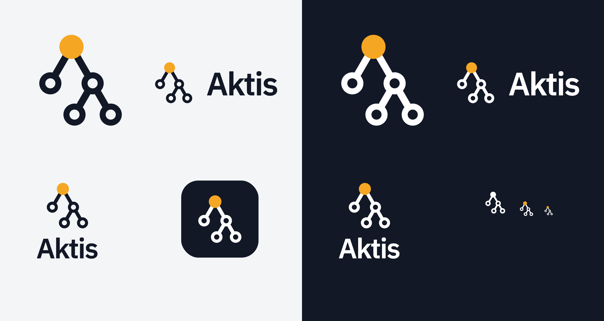

# Aktis brand assets

Colors: ink `#121826`, accent `#F5A623`.

| File | Use |
| --- | --- |
| `aktis-lockup.svg` / `aktis-lockup-1600.png` | Horizontal mark + wordmark, for light backgrounds |
| `aktis-lockup-white.svg` / `aktis-lockup-white-1600.png` | Horizontal lockup, for dark backgrounds |
| `aktis-lockup-mono.svg` | Horizontal lockup, single color |
| `aktis-lockup-stacked.svg` / `aktis-lockup-stacked-white.svg` | Stacked lockup, light / dark backgrounds |
| `aktis-mark.svg` / `aktis-mark-white.svg` | Mark only, light / dark backgrounds |
| `aktis-mark-mono.svg` / `aktis-mark-white-mono.svg` | Mark only, single color (ink / white) |
| `aktis-tile.svg` / `aktis-tile-circle.svg` | Mark on a dark rounded-square / circle tile (app icon) |
| `aktis-avatar-512.png` / `aktis-avatar-circle-512.png` | 512px avatars (GitHub org, Slack app, etc.) |
| `aktis-favicon-32.png` / `aktis-favicon-180.png` | Favicon / Apple touch icon |
